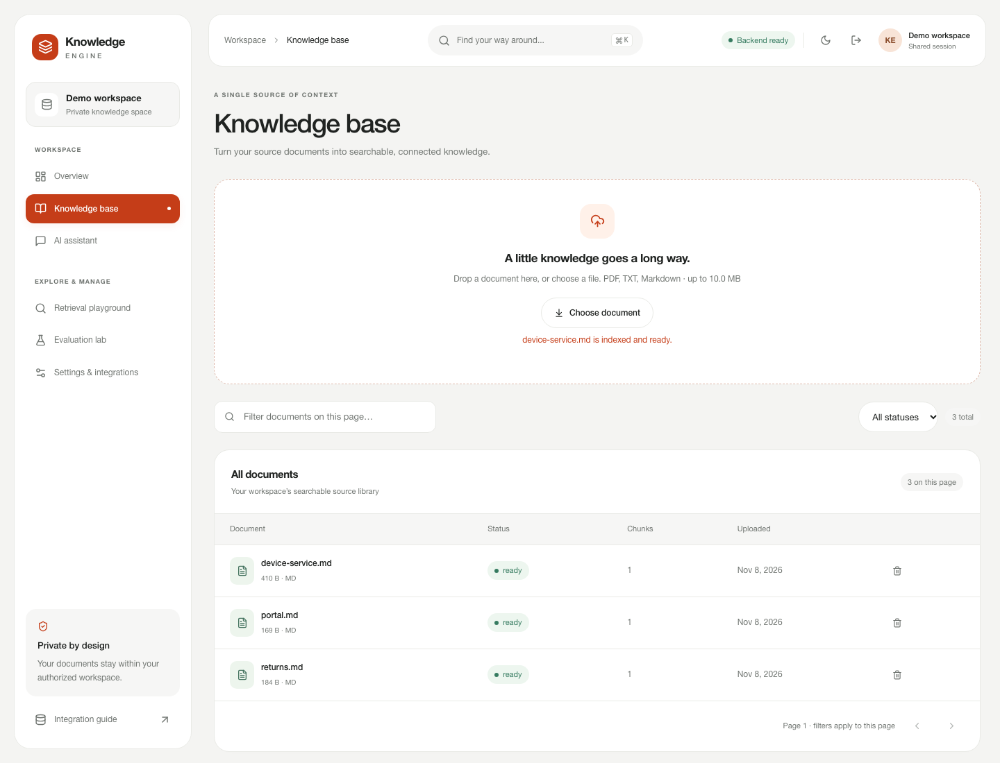
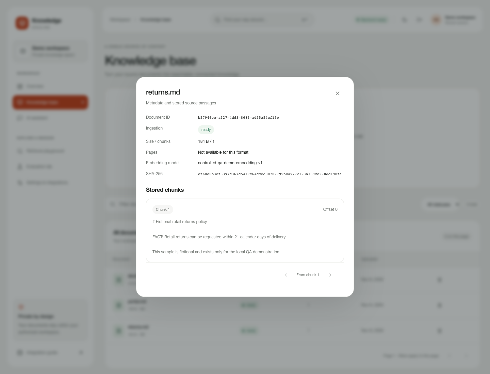
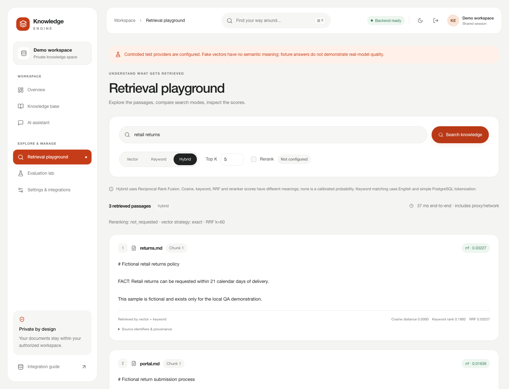
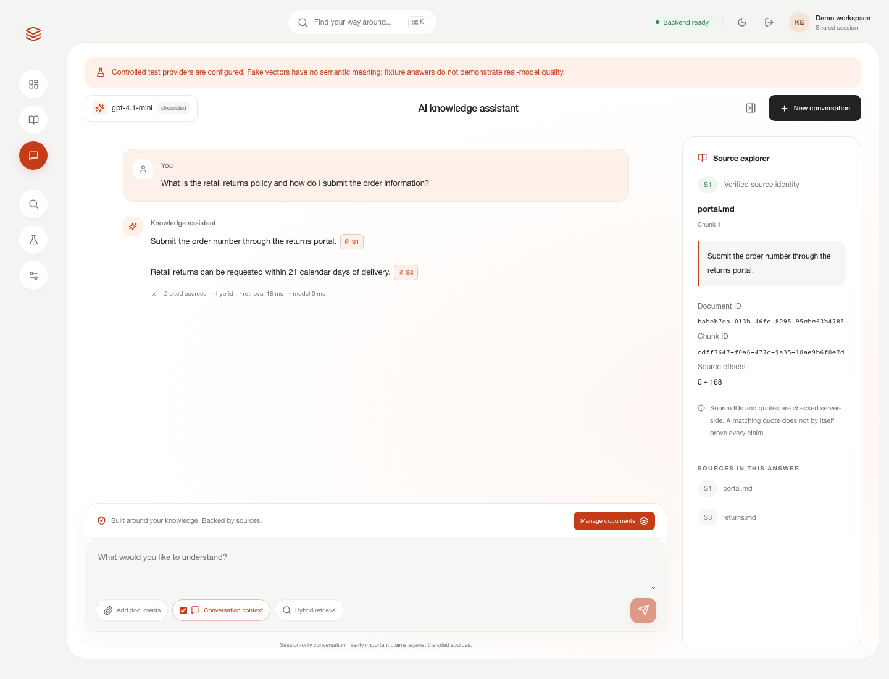
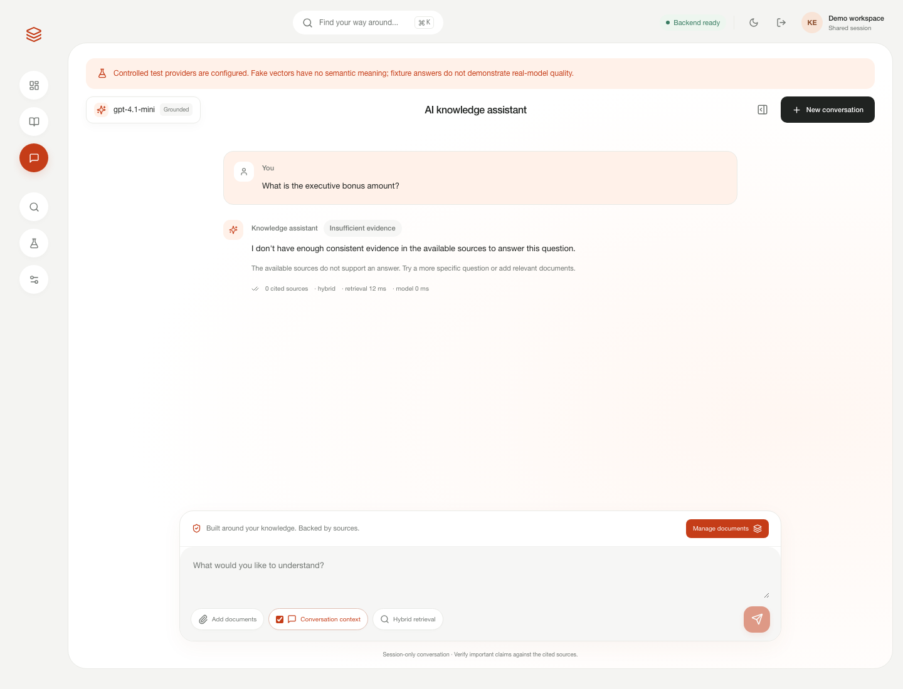
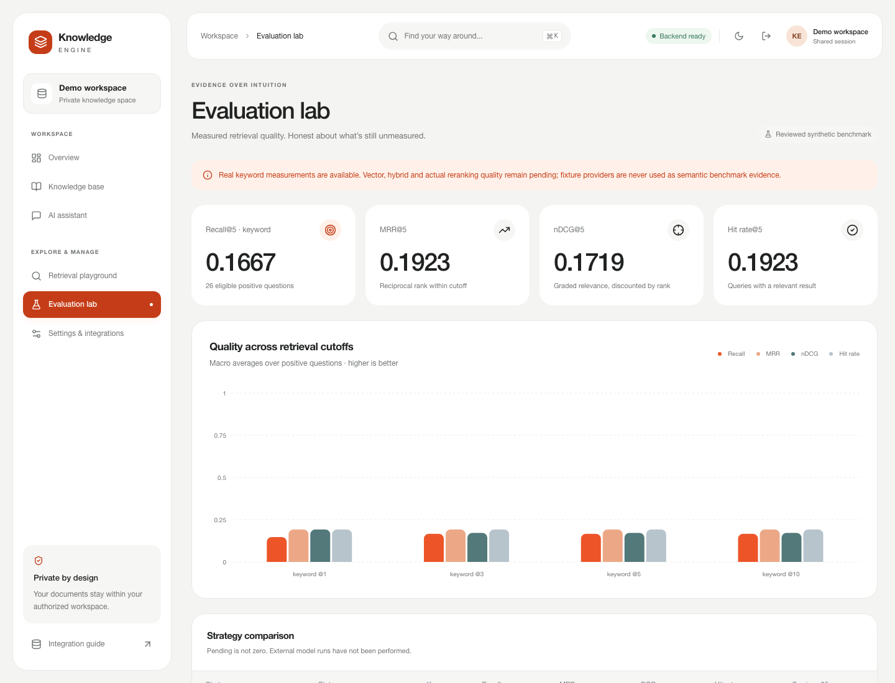
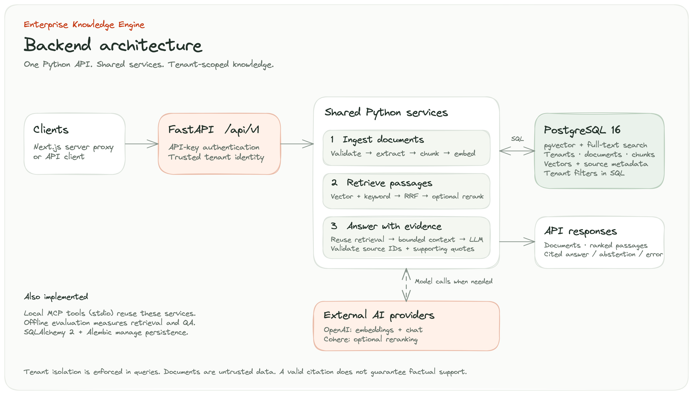

# Enterprise Knowledge Engine

A tenant-scoped knowledge workspace: a Next.js SaaS frontend over a Python API for document ingestion, hybrid retrieval and source-cited answers, with local MCP tools and reproducible evaluation.

[GitHub repository](https://github.com/mehdifassifihri/enterprise-rag-knowledge-engine)

## SaaS workspace

Six working pages: overview, knowledge base, cited AI assistant, retrieval playground, evaluation lab, and settings/integrations. The latest UI verification passed **30 frontend tests and five real-browser scenarios**, plus typecheck, lint and a production build; earlier backend verification is recorded in the linked phase reports. The UI uses real API responses and reviewed evaluation artifacts; it does not generate activity or benchmark data. Credentials remain in a password-protected Next.js server-side proxy bound to one tenant.

```sh
# First configure/migrate/provision the backend as described below, then make run.
cd frontend
npm ci
cp .env.example .env.local
# Configure server-only tenant key, APP_ORIGIN, demo password and signing secret.
npm run dev
# Open http://localhost:3000/login
```

[Frontend architecture, security, setup and exact 90-second walkthrough](docs/FRONTEND.md) · [Phase 8 verification](docs/verification-phase8.md)

For a free, real browser → Next.js → FastAPI → PostgreSQL integration demo using explicitly controlled providers: build the frontend, install Playwright Chromium, then run `.venv/bin/python scripts/demo_frontend.py` from the root against a migrated disposable database. Add `--interactive` to explore it manually. Scripted fixture outputs are not semantic-quality evidence.

Actual synthetic-demo screenshots and reproduction instructions are in [the screenshot guide](docs/screenshots/README.md). They were captured from the running application, not generated design mockups.

## RAG in action

**Upload → extract & chunk → retrieve → answer with citations → inspect the evidence.**

These are unmodified screenshots of the running application at **1440 × 1100**, using three fictional documents from [`examples/qa/`](examples/qa/). The browser, authenticated proxy, API, PostgreSQL queries, stored chunks and citation checks are real. **Embeddings and answers use deterministic demo providers**, explicitly labeled in the UI: these screenshots demonstrate the workflow, not real-model relevance, hallucination resistance or semantic benchmark quality. The evaluation image displays the separately executed keyword benchmark.

### 1 · Build a searchable knowledge base



**Labels:** **Ready** = ingestion completed successfully · **Chunks** = persisted searchable passages · **Uploaded** = stored upload timestamp. PDF, TXT and Markdown uploads use the same validated ingestion API; this capture uses Markdown fixtures.

### 2 · Inspect the source passages



**Labels:** **SHA-256** identifies the uploaded content · **Embedding model** records the provider used for indexing · **Chunk / offset** locates a stored passage. Markdown has no PDF page number; the UI reports that explicitly. Original upload bytes are not retained.

### 3 · See what hybrid retrieval actually returns



**Score legend:** **Vector + keyword** identifies the candidate sources · **Cosine distance** is lower for closer vectors · **Keyword rank** is PostgreSQL's lexical relevance score · **RRF** combines ranking positions with k=60. RRF is **not a probability**. The identical fixture vectors are not semantic evidence; this view demonstrates the executed SQL retrieval and fusion pipeline. The displayed elapsed time includes browser/proxy/network overhead and is not a capacity benchmark.

### 4 · Answer across documents, then inspect each citation



**Question:** “What is the retail returns policy and how do I submit the order information?”

| On-screen label | What it demonstrates |
|---|---|
| **Inline S# references** | Clickable IDs assigned to supplied retrieved chunks; only the cited subset appears in the answer. |
| **2 cited sources** | The response uses the separate eligibility policy and submission-process document. |
| **Source explorer** | The selected source's filename, document/chunk IDs, offsets and supporting excerpt. |
| **Supporting quote** | Both returned citations were checked against actual stored chunks during capture. Quote membership establishes traceability, not proof that every claim is entailed. |

The wording is produced by the explicitly scripted demo adapter. Real OpenAI generation follows the same retrieval/context/citation interfaces but is not evaluated by this image.

### 5 · Abstain when the available evidence cannot answer



**Labels:** **Insufficient evidence** is an explicit answer status · **0 cited sources** means no answer citations are returned. This controlled scenario verifies response handling and the UI's abstention state; it does not measure how reliably a real model detects missing evidence.

### 6 · Measure retrieval quality honestly



**Metric legend:** **Recall@K** measures relevant-document coverage · **MRR@K** rewards the first relevant result within the cutoff · **nDCG@K** accounts for graded relevance and rank · **Hit rate@K** measures queries with at least one relevant result. The K=5 cards show the measured keyword baseline over **26 eligible positive questions** from the separate **34-question benchmark**, not the three-document screenshot corpus. Vector/hybrid/reranking comparisons remain pending; these low lexical scores are not presented as a quality success.

**Reproduce the gallery:** after building the frontend and configuring a migrated local PostgreSQL/pgvector database, run:

```sh
.venv/bin/python scripts/demo_frontend.py --screenshots
```

The capture command creates an isolated tenant, uploads only public fictional fixtures, verifies two stored-source citations and abstention, writes six PNGs plus a [capture manifest](docs/screenshots/rag-showcase/manifest.json), and removes its temporary tenant on normal exit. It makes **no paid AI calls** and does not change the regular workspace. [Screenshot provenance and setup](docs/screenshots/README.md).


## Problem

Company knowledge is spread across files. Useful answers require finding relevant passages, preserving ownership boundaries and showing inspectable evidence. This project implements that backend workflow and makes its unverified behavior explicit.

## Verified capabilities

The previous publication verification passed **307 tests** against PostgreSQL 16/pgvector, including 65 integration tests. The synthetic API and official MCP subprocess demos pass, and Alembic reports no schema drift. These checks verify local behavior with controlled providers; see [final audit](docs/FINAL_AUDIT.md) and [verification](docs/FINAL_VERIFICATION.md).

- PDF/TXT/Markdown validation, bounded extraction and overlapping chunks.
- Tenant-scoped persistence, duplicate hashes, atomic ready/failed states and reprocessing.
- SQL cosine and full-text candidate queries, deterministic RRF and explicit reranker fallback.
- Structured answer parsing, authorized source IDs, exact supporting quotes and safe errors.
- Strict local MCP tools, bounded evaluation metrics and security regression tests.

OpenAI and Cohere adapters are implemented and mocked in tests; paid connectivity and real-model quality are pending. No cloud deployment, knowledge graph or persistent memory is claimed. The backend and new frontend remain subject to the verification boundaries described below.

## Architecture



**Flow:** client → authenticated FastAPI → shared ingestion, retrieval and grounded-answer services. PostgreSQL stores tenant-scoped documents, chunks and vectors; external providers supply embeddings, chat and optional reranking. Source checks support traceability, not a guarantee of factual correctness.

[Editable Excalidraw source](docs/diagrams/backend-architecture.excalidraw) · [Full-size diagram](docs/diagrams/backend-architecture.png)

[Detailed architecture and decisions](docs/ARCHITECTURE.md).

## Stack

Next.js 16, React 19, TypeScript, Tailwind, shadcn-style Radix components, TanStack Query, Recharts, Zod; Python 3.12+, FastAPI, Pydantic v2, SQLAlchemy 2, Alembic, PostgreSQL 16, pgvector >=0.8, pypdf, OpenAI SDK, official MCP SDK 1.30.0, pytest, Ruff and Docker Compose. Runtime/dev lock files pin Python packages; image tags and artifact hashes remain a reproducibility limitation.

## Quick start

Docker Engine + Compose and Python 3.12+ are prerequisites. The Compose PostgreSQL/pgvector service has been exercised locally; full API/frontend container builds remain unverified.

```sh
make setup
cp .env.example .env
chmod 600 .env
# Generate two independent values; paste them into .env, never commit them:
.venv/bin/python -c 'import secrets; print(secrets.token_hex(32)); print(secrets.token_urlsafe(40))'
# Set POSTGRES_PASSWORD and the matching DATABASE_URL password; set API_KEY.
# Keep API_KEY_TENANT_ID at the example UUID or choose your own UUID.
# For the free fixture demo, set EMBEDDING_PROVIDER=fake and LLM_PROVIDER=fake.
make db-up
make migrate
.venv/bin/python -m enterprise_knowledge_engine.provision \
  --id 11111111-1111-1111-1111-111111111111 --name 'Synthetic demo' --slug synthetic-demo
make run
```

For the complete container stack after configuring `.env`: `docker compose up --build -d`; then provision the same UUID with `docker compose exec api python -m enterprise_knowledge_engine.provision --id 11111111-1111-1111-1111-111111111111 --name 'Synthetic demo' --slug synthetic-demo`. `/health` is liveness; `/ready` checks DB, vector extension and migration head. `DOCS_ENABLED=true` enables `/docs` and `/openapi.json`.

## Environment

[.env.example](.env.example) documents every setting. Required: `DATABASE_URL`, strong `API_KEY`, and a provisioned `API_KEY_TENANT_ID` for knowledge access. Additional tenant bindings use `TENANT_API_KEYS` JSON. Never accept a tenant ID from request fields as authority.

OpenAI embeddings/chat require `OPENAI_API_KEY`; defaults are `text-embedding-3-small`, **1536 dimensions**, and `gpt-4.1-mini`. Dimensions are schema-fixed: changing them requires migration and re-embedding. Optional Cohere reranking requires `RERANKER_PROVIDER=cohere` and `COHERE_API_KEY`. Limits cover upload/extraction/chunks/candidates/context/model output, retries and timeouts. Real provider calls incur charges; fake embeddings have no semantic meaning and the default fake LLM abstains.

## Ingestion

Upload → validate content and size → extract → normalize → chunk → batch embeddings → atomic chunk/vector persistence. Only successful completion marks a document ready. SHA-256 detects per-tenant duplicates (409). Re-upload with `reprocess=true` to replace a ready document; failed processing retains no partial ready chunks. Original bytes are not retained. No OCR or remote URL fetching.

## Hybrid retrieval

Vector search ranks cosine distance inside PostgreSQL. Keyword search uses stored English/simple tsvectors, GIN indexes, `websearch_to_tsquery` and `ts_rank_cd`. Independent bounded candidates merge by Reciprocal Rank Fusion, default k=60, with chunk deduplication and deterministic ties. RRF is a ranking score, never a probability. Exact vector search is default; optional HNSW is approximate and may fall back to exact on underfill. Default no-op reranking preserves order; managed reranker failures explicitly fall back.

Identifiers can favor lexical search; paraphrases may favor real embeddings. Full-text punctuation/stemming do not guarantee arbitrary exact-string matches. Hybrid superiority has **not** yet been measured on this dataset.

## Grounded Q&A and citations

`/ask` reuses retrieval, gates weak evidence and constructs bounded context. Source text and optional bounded history are untrusted data. Structured claims must reference supplied source IDs and exact quotes; the server creates citation markers and metadata. Empty/insufficient evidence abstains; model/schema/citation errors remain errors. Valid quote membership establishes traceability, not semantic entailment or guaranteed hallucination prevention. History is request context, not trusted evidence or long-term memory.

## MCP

`make mcp` starts a tenant-bound **stdio-only** server using `MCP_API_KEY` from ignored configuration. Five read-only tools: `search_knowledge`, `ask_knowledge`, `list_documents`, `get_document`, `get_document_chunks`. The official SDK demo uses real subprocess protocol calls. Remote HTTP/OAuth and autonomous action tools are absent. See [MCP setup](docs/mcp.md).

## Evaluation

The versioned synthetic corpus has 12 documents, two tenants and 34 questions (26 positive, eight negative). Metrics deduplicate documents and report Recall/Precision/MRR/nDCG/Hit@K, with explicit error and zero-relevance handling. The measured keyword baseline has Recall@5 **0.1667**, MRR@5 **0.1923**, nDCG@5 **0.1719**: weak natural-language lexical coverage, not a success claim. Real vector/hybrid/rerank and answer-quality comparisons remain pending. [Benchmarks](docs/BENCHMARKS.md) · [methodology and paid-call controls](docs/EVALUATION.md).

## Security and tenant isolation

Trusted environment key bindings, constant-time credential comparison, SQL tenant predicates, composite tenant foreign keys, read-only MCP transactions, bounded file parsing, safe errors and content-free structured logs are implemented. No RLS, global rate limiter, tenant quota, identity federation or security certification. Revocation configuration requires restarting all workers. Use synthetic data until provider/privacy/deployment controls are reviewed. [Security model](docs/SECURITY.md).

## API reference

| Method | Path | Purpose |
|---|---|---|
| GET | `/health`, `/ready` | Public probes |
| GET | `/api/v1/info` | Authenticated service info |
| POST | `/api/v1/documents/upload` | Multipart file, optional reprocess |
| GET | `/api/v1/documents` | Bounded list: limit/offset |
| GET / DELETE | `/api/v1/documents/{id}` | Tenant-owned metadata / deletion |
| GET | `/api/v1/documents/stats`, `/api/v1/documents/{id}/chunks` | Tenant aggregates / bounded source previews |
| GET | `/api/v1/capabilities` | Safe provider/limit configuration |
| POST | `/api/v1/search` | vector, keyword or hybrid retrieval |
| POST | `/api/v1/ask` | Cited answer / abstention / error |

## Examples

Set `API_KEY` securely in your shell to match ignored configuration; never paste actual keys into repository files. A real upload/search/ask uses the configured providers and may incur charges.

```sh
curl --fail http://127.0.0.1:8000/ready
curl --fail -H "X-API-Key: $API_KEY" \
  -F file=@demo/sample_documents/returns.md http://127.0.0.1:8000/api/v1/documents/upload
curl --fail -H "X-API-Key: $API_KEY" -H 'Content-Type: application/json' \
  -d '{"query":"retail returns","mode":"hybrid","top_k":5,"rerank":false}' \
  http://127.0.0.1:8000/api/v1/search
curl --fail -H "X-API-Key: $API_KEY" -H 'Content-Type: application/json' \
  -d '{"question":"What is the retail returns policy?","top_k":5,"search_mode":"hybrid","rerank":false}' \
  http://127.0.0.1:8000/api/v1/ask
```

Responses include document IDs/status/chunk counts, retrieval provenance and, for answered questions, authorized source metadata and supporting excerpts. Exact generated wording depends on the provider. No fabricated response transcript is supplied. For a free, deterministic assertion-based walkthrough: `bash demo/demo_requests.sh`; read [demo boundaries](demo/README.md) first.

## Tests and CI

```sh
make lint
make test
make migrate
RUN_DB_TESTS=1 make test-integration
make evaluate-validate
make audit
```

Automated tests mock paid APIs. CI defines Python 3.12/3.13 checks, PostgreSQL integration, migration roundtrips, advisory scanning and Docker build. A frontend CI job additionally defines typecheck/lint/component/security checks, production build and real browser/PostgreSQL integration. Remote CI status is unverified. [Exact local evidence](docs/FINAL_VERIFICATION.md).

## Engineering tradeoffs

Synchronous ingestion holds DB transactions during inference, keeping atomic behavior simple at bounded scale. PostgreSQL consolidates vector/lexical/metadata storage; exact search favors recall over ANN speed. Environment credentials simplify local operation but require coordinated restarts for revocation. Minimal typed interfaces avoid a large orchestration framework.

## Known limitations

No OCR, durable queue, source object storage, knowledge graph, persistent conversation memory or deployed cloud environment. The frontend demo is single-tenant; it does not implement multi-user SaaS identity. Real embedding/chat/rerank quality and cost are unverified; citation checks do not prove factual support. Full API/frontend container builds and remote CI remain unexecuted locally. Licensing is pending owner decision; no MIT grant is implied.

## Next improvements

Measure real semantic and reranker baselines; review failure cases before tuning retrieval. Add human-calibrated grounded-answer evaluation, workload/query-plan testing, least-privilege DB roles/RLS assessment, admission controls, durable jobs, backup drills and deployment verification as requirements justify them.

[Portfolio](docs/PORTFOLIO.md) · [90-second demo script](docs/DEMO_SCRIPT.md) · [Publication checklist](docs/PUBLICATION.md) · [Release notes](docs/RELEASE_NOTES.md)
