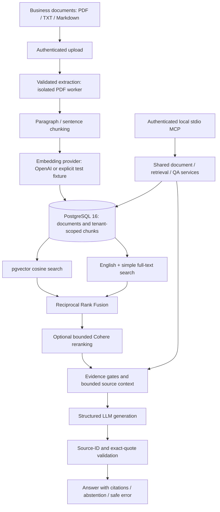

# Architecture

Vector-only and keyword-only modes bypass fusion. The default reranker preserves order; it does not claim to improve relevance. HTTP and MCP call the same services. The diagram shows implemented paths; external model quality and connectivity remain unverified locally.

## Responsibilities and storage

The `src/enterprise_knowledge_engine` package separates HTTP transport (`api`), configuration/authentication/logging (`core`), persistence (`db`), ingestion, retrieval, QA, MCP and offline evaluation. Typed provider protocols permit deterministic tests without paid calls; dependency injection does not replace production providers silently.

Tenant UUIDs own documents; documents own ordered chunks. A composite tenant/document foreign key prevents mismatched ownership. Tenant/hash uniqueness prevents duplicate uploads. Metadata includes filename, SHA-256, size, extraction/page information, processing state and actual embedding model/dimension. Chunks carry text, positions/offsets, optional pages, VECTOR(1536), and generated English/simple tsvectors. Indexes cover tenant document listing, chunk position, both GIN text vectors and cosine HNSW. Migration head is `0003_retrieval`; deployment dimensions must match the schema.

PostgreSQL keeps metadata, transactional state, vectors and lexical search together. This reduces operational services and preserves a consistent read snapshot. Exact vector search computes distance inside PostgreSQL over a tenant-filtered CTE; it does not use HNSW by default. Optional HNSW trades recall for speed and falls back to exact retrieval on underfill. Large-corpus index utilization, latency and migration locks require measurement.

Independent semantic and lexical candidate lists address different matching behavior. RRF combines ranks without treating incompatible raw scores as comparable probabilities. Managed reranking adds external data transfer, latency and cost; its failure returns the original ranking with explicit provenance. Real relevance improvements require evaluation.

## Trust, failure and cost boundaries

Environment API keys bind to server-selected tenants. SQL predicates constrain both chunk and parent document at query time. MCP binds one tenant per trusted local process and uses read-only transactions. Application predicates are the authorization boundary: database RLS, identity federation and per-document ACLs are absent.

Source text/history are untrusted JSON data, never executable instructions. Context/source/output budgets constrain generation. Server validation proves supplied source identity and quote membership, not that every claim is entailed. Insufficient evidence produces abstention; provider/schema/citation failures produce explicit errors. No real-model injection guarantee is claimed.

Synchronous ingestion holds a transaction across embedding calls. Hash locks, row locks and savepoints prevent false readiness and partial chunks; crashes roll back. Reprocessing requires re-upload because source bytes are not retained. This favors correctness for bounded uploads over high-throughput durable jobs. Retries are bounded but can repeat billed inference after ambiguous failures. Logs omit private text and keys. See [security](SECURITY.md), [evaluation](EVALUATION.md) and the detailed decisions below.

## Detailed implementation decisions

### Decisions recorded across Phases 1–6

## Boundaries

Keep the src-style FastAPI application factory, JSON logging, Pydantic Settings, request-scoped synchronous SQLAlchemy sessions and explicit Alembic migrations established in Phase 1. `api/v1/documents.py` validates HTTP inputs and serializes typed responses. `ingestion/extraction.py` handles source validation and text normalization; `chunking.py` is a reusable pure service; `embeddings.py` defines a typed provider protocol and OpenAI/fake implementations; `service.py` coordinates transactions. Phase 3 adds a small retrieval module; no LangChain is required.

Pydantic validates chunk overlap, model, dimensions, limits and key uniqueness at startup. Upload size is enforced both before multipart parsing and on the actual file. PDF parsing is isolated in a timed subprocess; on Linux, resource limits bound CPU and memory. A PDF is never accepted solely because its extension or content type says PDF. TXT/Markdown use strict UTF-8 decoding and control-character checks. Neither format is rendered or executed.

## Authentication and tenant ownership

Extend the Phase 1 API-key dependency to return a principal. Environment configuration binds credentials to tenant UUIDs. The bootstrap credential remains valid for service information, but an unbound credential is forbidden from document access. Additional keys live in a secret-valued, non-repr mapping. Tenant records are provisioned administratively. Tenant IDs supplied by callers have no authority.

Every list, get, delete, deduplication and chunk write includes the principal's tenant UUID. Unknown and cross-tenant IDs produce identical 404 responses. PostgreSQL also enforces chunk/document tenant consistency through the existing composite foreign key. This is application-enforced authorization, not RLS; a compromised unrestricted SQL account could access every tenant. Dedicated database roles, RLS, rotation and quotas remain deployment hardening work.

## Persistence and failure semantics

A unique `(tenant_id, content_hash)` constraint is the final duplicate guard. A nonblocking transaction-level advisory lock derived from tenant and hash prevents concurrent uploads from duplicating embedding requests. A row lock serializes replacement with deletion. PostgreSQL transactions remain open during embedding generation; this favors correctness and maintainability for bounded synchronous ingestion over throughput.

The outer transaction owns the document and clears old chunks on a reprocess. A savepoint wraps embedding generation and chunk insertion. Success commits vectors and `ready` state atomically. A handled failure rolls back the savepoint and commits a safe error code, `failed` state and zero chunks. Process crashes or database commit failures roll back the outer transaction, preserving the previous committed state. There is no externally durable `processing` marker or stuck-job recovery problem in this synchronous design. Source bytes are not retained; retry requires re-uploading the same file. Failed hashes reuse their document ID. Ready hashes require explicit `reprocess=true`.

Documents record the actual embedding provider/model and dimension. The OpenAI adapter uses batched `text-embedding-3-small` by default, an explicit timeout and one retry. It reorders results by provider index and validates indices; the service verifies count, finite floats and dimensions before writes. The fake provider uses normalized SHAKE-256-derived vectors, never Python's randomized hash. Tests cannot demonstrate semantic quality using fake vectors.

`VECTOR(1536)` is deliberately fixed in migration history and checked against deployment configuration. Dimension changes require a reviewed migration and re-embedding; migrations do not depend on environment-selected dimensions. Phase 1 rows have nullable new source metadata/vectors and remain `pending`. Phase 3 introduces the cosine HNSW index and explicit exact/approximate query strategies described below.

## Operations and security

`/health` is database independent; `/ready` checks PostgreSQL, pgvector and revision `0003_retrieval`. Probes remain public. OpenAPI/docs are opt-in. Unexpected and database errors have generic responses. Structured logs record generated request IDs, route templates, status and elapsed time, excluding raw paths, bodies, query strings, keys, source text and exception messages. SDK debug logs are suppressed. The parser subprocess receives a minimal environment without API credentials.

Compose uses PostgreSQL 16 with pgvector, runs a separate migration service, and starts a non-root API on loopback. Local and CI accounts are administrative convenience accounts; they are not a verified deployment security model. Direct requirements use version ranges; committed runtime/dev lock files pin resolved Python versions. Images still use tags and artifact hashes/signatures are deferred. Docker health checks use readiness rather than liveness.

Unit tests exercise extraction, normalization, chunk coverage, invalid configuration, authentication and mocked provider behavior. Integration tests require real PostgreSQL with pgvector and verify persisted vectors, cross-tenant hiding, duplicate races, cleanup and retry semantics. SQLite is not used to claim PostgreSQL compatibility.

## Deliberate limitations

No OCR, durable task queue, source object storage, remote URL ingestion, persistent chat memory or frontend. PDF layout fidelity is limited by text extraction. CPU/memory isolation is strongest in the Linux container; global request concurrency and slow-client limits require proxy/process controls. Tenant authorization and synchronous persistence are implemented, but production readiness needs workload, security and operational verification.

## References

- [OpenAI embeddings API parameters and input limits](https://developers.openai.com/api/reference/resources/embeddings/methods/create)
- [pgvector SQLAlchemy integration](https://github.com/pgvector/pgvector-python#sqlalchemy)
- [pypdf text extraction and limitations](https://pypdf.readthedocs.io/en/stable/user/extract-text.html)
- [SQLAlchemy composite constraints](https://docs.sqlalchemy.org/en/20/core/constraints.html)

## Phase 3: retrieval

`retrieval/repository.py` owns parameterized PostgreSQL candidate queries. Both the chunk and parent-document tenant UUID are constrained in SQL, and only ready documents are visible. Vector queries additionally match the actual provider/model and schema dimension and exclude null/zero vectors. The existing embedding provider is reused for a single query; zero vectors are now rejected during ingestion too, because cosine distance is undefined for them.

The default exact query uses a materialized tenant-filtered CTE and SQL distance sorting, returning only a bounded pool. The optional HNSW query enables strict iterative scans and falls back to exact selection on underfill. A full ANN pool remains approximate and carries a warning. HNSW does not promise deterministic membership across equal-distance boundary ties or rebuilds; result ordering within the returned pool uses distance and UUID. Exact mode supplies deterministic membership/ranking for an unchanged corpus. Shared ANN recall can depend on other tenants, while SQL filters still enforce data access isolation.

Generated stored English and simple tsvectors plus two GIN indexes avoid application-side tokenization drift. `websearch_to_tsquery` safely parses bound query values; `ts_rank_cd` rewards term proximity, and normalization 32 bounds each rank without making it probabilistic. Taking the maximum English/simple score yields one lexical list. Stemming and punctuation tokenization are useful but do not guarantee arbitrary exact identifier/string matching.

`ranking.py` sorts bounded candidates, deduplicates by chunk ID, and combines independent 1-based source ranks using RRF with configurable k=60. Raw distances, source ranks, lexical score and fusion score remain visible. It does not combine incompatible raw score scales or label scores as probabilities. Exact vector and keyword ties, fusion ties and reranker score ties use chunk UUIDs.

`reranking.py` defines an index-based provider contract, so provider output cannot inject arbitrary chunks. The default no-op preserves retrieval scores and reports that it did nothing. Optional Cohere reranking sends at most a capped, truncated same-tenant candidate list; it validates a complete permutation and score values. Errors revert to the original retrieval order with an explicit fallback status and safe warning. Reranker provenance and scores remain separate from retrieval evidence. Managed relevance improvements require corpus evaluation and are not claimed here.

`POST /api/v1/search` uses the existing tenant principal and dependency overrides. Query size, mode, top_k and optional rerank are validated; caller-supplied tenant fields are forbidden. A repeatable-read read-only transaction makes both candidate lists consistent with one snapshot; optional external reranking happens afterward. Embedding failure aborts vector/hybrid searches explicitly, while keyword-only does not invoke embeddings. Empty compatible vector corpora skip the paid query embedding call.

A shared `core/errors.py` safely reports service errors while preserving the ingestion envelope. Logging still excludes query/document text and external exception details. Migration `0003_retrieval` requires pgvector >=0.8.0, backfills generated columns and builds GIN/HNSW indexes; index builds/table rewrites need a migration window for large deployed corpora. No online rollout or large-scale query-plan assumptions are claimed as verified. See README for configuration and [retrieval verification](verification-phase3.md) for executed checks.

## Phase 4: cited question answering

`api/v1/ask.py` uses the existing tenant principal, SQLAlchemy session and dependency-injected embedding/reranking providers. `qa/service.py` calls the actual Phase 3 `search` function; it does not implement a parallel retrieval path or fetch entire documents. No schema changes are needed, and migration head remains `0003_retrieval`.

`qa/context.py` gates candidates using raw semantic/lexical evidence rather than treating RRF as a probability, deduplicates chunks, and bounds source count and serialized source JSON characters. Prefix clipping preserves normalized offsets and marks truncated passages. Source IDs are assigned by the server for the current request. All citation metadata is copied from tenant-filtered retrieval results, never accepted from the LLM or caller.

`qa/prompts.py` isolates a narrow system instruction from a single user JSON data object. Current question, source text/metadata and optional history remain low-trust data. Prior assistant responses are not source evidence and cannot be promoted into system messages. History is bounded per request; there is no persistent memory or conversation table. Retrieval deliberately uses the standalone current question without an LLM query-rewriting step.

`qa/providers.py` defines a typed chat provider and completion/usage contract. The OpenAI adapter uses configurable model, timeout/retries, bounded output tokens, strict JSON schema and no tool access. The default deterministic fake abstains; only tests/demo explicitly script it. A real provider failure never silently becomes a fake response. Provider-reported model/token metadata is optional and separate from measured Python timings.

The output contract contains bounded claims and verbatim evidence quotes. Pydantic enforces shape and status invariants; `qa/citations.py` checks each ID and exact quote against only the context supplied to that request. It rejects the entire output on an invalid citation, quote, or model-inserted citation marker. Valid claims are rendered with server-created [S1] markers, and metadata/excerpts are assembled from authorized context. Multiple supporting quotes for one chunk remain visible in its citation entry.

This validates syntax, source identity and quote provenance, not semantic entailment. Contradiction/incomplete-evidence judgments rely on the generation model following the narrow instruction. A model could produce an unsupported paraphrase with a real quote; top-k retrieval and truncation can also hide conflicting evidence. There is no claim that prompting removes hallucinations, that regexes solve injection, or that fixture tests prove real-model robustness. A semantic grounding evaluation/verification stage is future work.

`insufficient_evidence` is a successful abstention with no citations; empty/weak contexts skip the model. Provider/schema/citation errors produce an explicit `error` status and appropriate HTTP error, preserving empty citations and safe categories. Optional retrieval reranking retains its existing fallback policy. Structured events carry request ID, tenant UUID, durations, counts and usage without question/source text or exception bodies. Request middleware now exposes its generated ID through request state so QA response/log correlation matches the response header.

The free demo uses a fresh tenant, real ingestion/search and deliberately controlled model fixtures. Real PostgreSQL tests verify source/citation isolation, multi-document answers, outside-scope and conflicting-evidence abstentions, prior assistant untrustworthiness and injection-data handling. Real-model prompt-injection robustness, factual support, external API connectivity and cost/latency behavior remain unverified until tested with authorized paid calls and representative evaluations.

## Phase 5: local MCP adapter

`mcp/server.py` uses official FastMCP with strict schema validation, bounded dispatch and safe MCP error envelopes. `mcp/runtime.py` binds the existing API-key principal once at stdio startup, opens fresh tenant-scoped sessions and delegates to existing retrieval/QA services. Shared document DTOs/list reads now live in `documents/`; provider factories have framework-independent builders. No schema migration or HTTP route changes are required. Read-only connection transactions provide defense in depth, while SQL tenant predicates remain the authorization boundary. Runtime cleanup disposes the engine; worker cancellation waits for cleanup. See [MCP design and security boundaries](mcp.md).

## Phase 6: evaluation and hardening

`evaluation/` in the src package provides dataset validation, deterministic metrics, recording answer checks, an optional structured OpenAI judge, isolated administrative indexing and an HTTP load harness. Publishable synthetic data/reviewed reports live in the repository-level `evaluation/`; default local results are ignored. The adapter reuses extraction/chunking, real embedding ingestion, retrieval and QA services. Keyword-only fixtures store NULL vectors, never fake semantic embeddings. No database schema changes are needed.

`core/telemetry.py` propagates request correlation into content-free embedding/retrieval timing events. HTTP validation errors omit rejected values; shared credential resolution checks configured revocation digests, and MCP revalidates the bound principal on each call. Provider factories and REST/MCP interfaces are preserved. Version locks, CI advisory scanning and regressions support reproducibility without implying production security. Details and boundaries are in [EVALUATION.md](EVALUATION.md) and [SECURITY.md](SECURITY.md).
