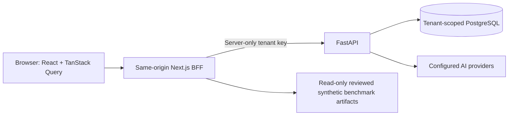

# SaaS frontend — Phase 8

The current visual system and redesign verification are documented in [UI_REDESIGN.md](UI_REDESIGN.md). All pages share responsive panels and light/dark support, with a Cmd+K / Ctrl+K navigation finder. The assistant uses a focused chat layout using the shared website palette with an icon rail, illustrated welcome, bottom composer, and collapsible citations.

## What exists

`frontend/` is a Next.js App Router application with TypeScript, Tailwind v4, owned shadcn-style Button/Dialog components using Radix/CVA, Lucide icons, TanStack Query, Recharts, next-themes and Zod. All business data comes from FastAPI or the reviewed synthetic evaluation files. There is no mock API mode in the application.

| Route | Behavior |
|---|---|
| `/dashboard` | Actual tenant document/ready/failed/chunk counts, recent uploads, DB readiness, quick actions |
| `/knowledge` | Single-file drag/drop upload, transfer progress followed by indexing state, bounded paginated list, page-local filters, metadata/chunk preview, confirmed deletion |
| `/assistant` | Actual `/ask` responses, inline source buttons, source/excerpt panel, abstention and error states, optional bounded history |
| `/playground` | Vector/keyword/hybrid, top_k 1–50, managed rerank only when configured, actual passages and score provenance |
| `/evaluation` | Actual committed report metrics/chart, pending strategies, per-question ranked labels, dataset conditions |
| `/settings` | Safe provider configuration booleans/models, backend readiness, MCP and local setup guide |
| `/login` | Password-protected shared demo session |

The UI uses light/dark CSS tokens, responsive grids, scrollable source tables, keyboard controls, reduced-motion support, accessible form labels, Radix focus trapping/Escape and focus restoration. Screenshots must be captured from an executed instance; they are not generated dashboard mockups.

## Architecture and contracts



`src/lib/contracts.ts` mirrors actual Pydantic responses with runtime Zod validation; `src/lib/api.ts` centralizes HTTP status handling. Route handlers allowlist methods/paths and pagination, validate search/ask inputs, cap buffered request bodies, reject cross-origin writes, and never forward caller credentials/tenant selectors. Upstream errors are sanitized; successful answers retain citation IDs, document/chunk identity, page/offsets, quotes, optional usage and measured model/retrieval timings. No source HTML or Markdown is executed.

TanStack Query deduplicates safe reads, avoids retries for client errors, and invalidates document/stats caches after upload/delete. Mutations do not retry automatically. An upload reaches 100% when its bytes finish transferring, **not** when extraction/embedding finishes. A later success requires the backend's ready response. An ambiguous timeout asks the user to inspect the list before retrying.

The frontend BFF integrates:

- `GET /ready`, `/api/v1/capabilities`, `/api/v1/documents/stats`.
- `POST /api/v1/documents/upload`, `GET /api/v1/documents` and `GET/DELETE /api/v1/documents/{id}`.
- `GET /api/v1/documents/{id}/chunks`, bounded to 20 items and 2,000 characters per preview.
- `POST /api/v1/search`, `POST /api/v1/ask`.

Phase 8 adds only read-only capability/aggregate/chunk endpoints to FastAPI; authentication and SQL tenant predicates are reused. Aggregate counts use actual stored rows. Cross-tenant chunk IDs return 404. No schema migration is required. Provider status means configured, not live connectivity. No additional CORS is necessary: browsers call Next on the same origin, and only its server talks to FastAPI.

## Authentication boundary

`BACKEND_API_KEY` stays in a `server-only` trust boundary and must be bound to one provisioned tenant through existing backend configuration. Do not configure an unbound bootstrap key or a broad administrative credential. No `NEXT_PUBLIC_*` credentials, browser API-key input, localStorage credential storage or browser tenant selector exist.

Login compares a separate `DEMO_PASSWORD` using fixed-length digests and issues an eight-hour HMAC-signed, HTTP-only, SameSite=Strict cookie. HTTPS origins set Secure. Writes require the exact configured `APP_ORIGIN`; host/forwarded headers are not used to choose the upstream or authorization. Signing secrets/password placeholders fail closed. Sign-out clears the cookie and Query cache; page refresh clears local chat state.

This is a **shared, single-tenant demo gate**, not a multi-user identity platform. Everyone with its password can access the server-bound tenant. Bind locally or protect an authorized demo deployment. Real SaaS needs user authentication, managed sessions/expiry/revocation, user-to-tenant authorization, CSRF/deployment review, rate/admission controls, TLS, provider privacy policies and security testing. There is no distributed login rate limiter; avoid publicly exposing this shared demo without gateway controls. Rotating SESSION_SECRET invalidates all cookies; there is no per-session revocation store. When changing the server-bound tenant, rotate the demo password and signing secret together so earlier demo sessions cannot carry over.

Security headers deny framing, reduce referrer leakage and disable unused browser permissions. CSP still permits inline scripts/styles for Next/theme/chart behavior; nonce-based strict CSP remains deployment work. No production security certification is implied.

## Run locally against configured providers

Verified toolchain: Node 24.8.0, npm 11.6.0, Python 3.13.9. Use Node 24 with the committed npm lockfile; the backend supports Python 3.12+.

1. Configure the root ignored `.env`, PostgreSQL 16/pgvector, migrate and provision a tenant as in README. Run `make run` (port 8000).
2. From a second terminal:

```sh
cd frontend
npm ci
cp .env.example .env.local
chmod 600 .env.local
# Generate independent DEMO_PASSWORD and SESSION_SECRET locally:
node -e 'const c=require("node:crypto"); console.log(c.randomBytes(24).toString("base64url")); console.log(c.randomBytes(48).toString("base64url"))'
# Edit .env.local; BACKEND_API_KEY must equal an existing tenant-bound backend key.
npm run dev
```

Open **http://localhost:3000/login**. Keep APP_ORIGIN exactly aligned with the browser URL (scheme/host/port); `localhost` and `127.0.0.1` are different origins. `.env.local` is private and ignored. Never include actual secrets in screenshots or shell scripts committed to the repo.

Server-only variables:

| Variable | Purpose |
|---|---|
| `BACKEND_URL` | Trusted FastAPI origin, default example 127.0.0.1:8000 |
| `BACKEND_API_KEY` | Existing tenant-bound API key; never returned to browser |
| `APP_ORIGIN` | Exact permitted browser write origin |
| `DEMO_PASSWORD` | Separate demo login password, at least 16 characters |
| `SESSION_SECRET` | Random signing key, at least 32 characters |
| `EVALUATION_REPORT_DIR` | Operator-selected reviewed report directory, no browser path input |

For production artifact verification: `npm run build && npm start`. The start script prepares static/public assets for Next's standalone server; default port 3000. Use HTTPS and deployment controls before remote exposure. No secrets are required at build time; missing runtime configuration fails closed.

## Free controlled integration demo

The harness starts real Next and FastAPI processes on loopback ports 3008/8018, creates a fresh tenant with ephemeral credentials, and uses the existing explicitly scripted embedding/LLM fixtures. It writes no secret env files, cleans up processes/tenant on normal/error exit, and does not make paid calls. Abrupt kills can leave fixtures. Ports must be free and the database must already be migrated.

```sh
cd frontend
npm ci
npm run build
npx playwright install chromium --only-shell
cd ..
# Root .env points to a disposable migrated PostgreSQL database.
.venv/bin/python scripts/demo_frontend.py
# Or explore the running fixture workspace yourself:
.venv/bin/python scripts/demo_frontend.py --interactive
```

Interactive mode prints a temporary **demo login password**, not a backend API key; do not record the login step. Upload files in `demo/sample_documents`. Identical vectors and FACT-line scripted answers test the browser/proxy/database/citation flow; they cannot establish real semantic quality or injection resistance. The UI visibly labels fake provider configuration. The normal application has no hardcoded answers or hidden fake fallback. Real inference requires the configured paid backend adapters and manual quality review.

## Exact 90-second walkthrough

- **0–10s:** Dashboard: explain real tenant totals and readiness; no activity is generated.
- **10–30s:** Knowledge base: upload `demo/sample_documents/returns.md`, wait for indexed status, open metadata and its stored chunk.
- **30–45s:** Playground: query `retail returns`, choose Hybrid, inspect the passage and RRF score. Explain that it is not a probability.
- **45–65s:** Assistant: ask `What is the retail returns policy?`, select S1 and inspect the quote. Ask `What is the executive bonus amount?` to show abstention. Disclose controlled fixtures if using the free harness.
- **65–80s:** Evaluation: show actual keyword Recall@5 0.1667, MRR 0.1923, nDCG 0.1719 and pending semantic strategies. Do not claim the measured baseline is strong.
- **80–90s:** Settings: explain shared backend services, local MCP integration and the boundary between a demonstrable backend and production authentication/deployment.

## Docker Compose

The existing backend stack remains the default. The `ui` profile adds the non-root Next standalone image on loopback port 3000. Configure root `.env` variables `FRONTEND_BACKEND_API_KEY`, `FRONTEND_DEMO_PASSWORD`, `FRONTEND_SESSION_SECRET`, optionally `FRONTEND_APP_ORIGIN`.

```sh
docker compose --profile ui config --quiet
docker compose --profile ui up --build -d
# Provision your configured backend tenant if not already present, then open /login.
```

The reviewed synthetic report directory is mounted read-only; no private evaluation directory is mounted by default. Credentials are injected at runtime, not image build args. Docker was unavailable locally, so container build/start is not claimed verified. Backend Docker context excludes the frontend and its node_modules.

## Checks and screenshots

```sh
cd frontend
npm run typecheck
npm run lint
npm run format:check
npm test
npm run build
npm run check:client
npm audit --omit=dev
# Root, with migrated disposable DB:
.venv/bin/python scripts/demo_frontend.py
```

The browser harness saves actual synthetic screenshots under ignored `frontend/test-results/`: dashboard-desktop, dashboard-mobile, dashboard-dark, assistant-desktop and evaluation-desktop PNGs. Inspect them and copy only reviewed synthetic captures to `docs/screenshots/` if desired for publication. Never substitute a design mockup for an executed screenshot. Tests visit every page at 390, 768 and 1440px, test Escape/focus return and dark mode; this is not a complete accessibility audit or all-browser/device certification.

## Limitations

No frontend user management, workspace switching, persistent chat, background job progress, multi-file batch upload, source-file download or backend modification of provider settings. Document filters apply to the loaded page and say so. Uploads are capped at 10 MiB in this BFF even if the backend is configured higher. The source panel shows supporting quote metadata; it does not prove entailment. Model errors stay errors, not fabricated successful answers. Query timings in the playground measure browser-to-proxy-to-backend roundtrip, not backend-only latency. Evaluations are a fixed operator-selected reviewed snapshot, not live private tenant results. Missing/malformed reports show unavailable, not invented metrics. MCP is documented, not executed by the browser. Paid API quality, Docker and remote CI remain separate verification items.
